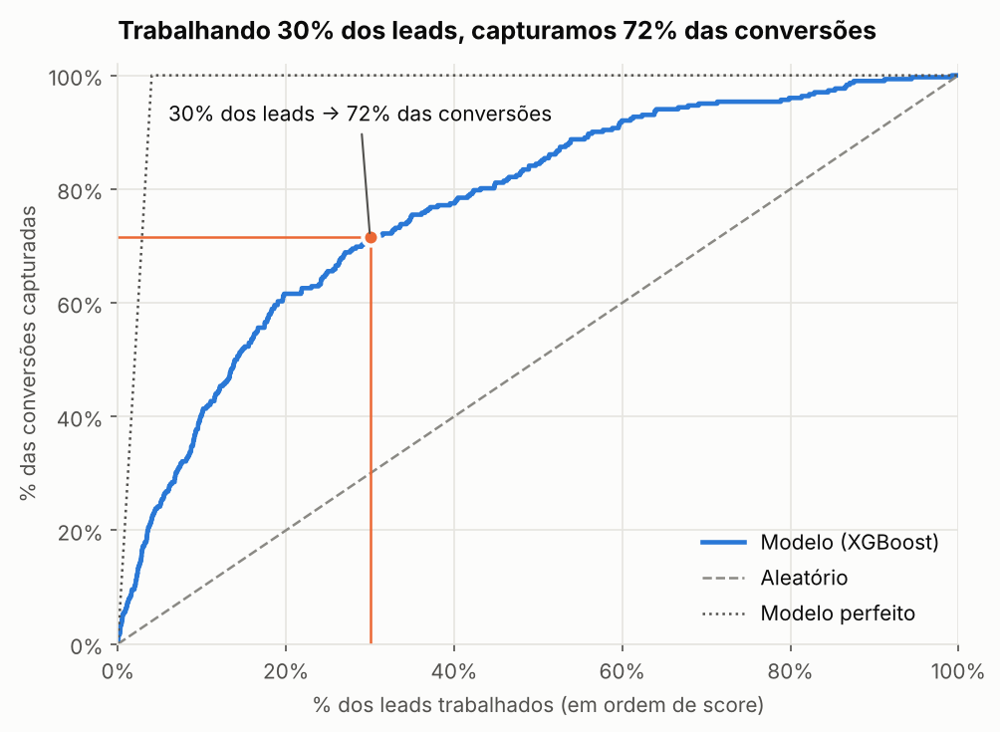
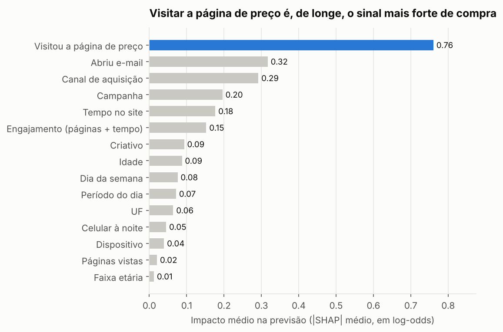
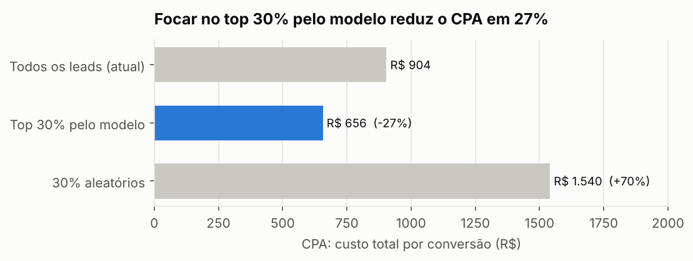

# Modelo de Propensão à Conversão de Leads

> ⚠️ **Aviso: todos os dados deste projeto são simulados.** A base de 50 mil leads foi gerada por `src/generate_data.py` (seed=42)
> para fins de portfólio. Os números ilustram o método e não representam nenhuma empresa, campanha ou pessoa real.

## Problema de negócio

Uma empresa de cursos online investe em Google Ads, Meta Ads, TikTok Ads, e-mail e orgânico, mas só **4% dos leads compram**.
O time comercial e o remarketing tratam todos os leads da mesma forma, e o custo por venda (CPA) fica alto.
**Objetivo:** prever, no momento do cadastro, quais leads têm maior chance de comprar, para concentrar verba e esforço neles.

## Principais resultados (conjunto de teste, dados simulados)

- **Trabalhando só os 30% de leads com maior score, a empresa captura 71,5% das vendas**, contra 30% escolhendo os leads ao acaso.
- **O CPA cai 27%, de R$ 904 para R$ 656**, considerando R$ 25 de esforço comercial e remarketing por lead trabalhado. O foco compensa a partir de ~R$ 8 por lead.
- **O decil de maior score converte 16,3%, 4 vezes a média** (lift acumulado de 2,4x nos 3 primeiros decis). PR-AUC de 0,15, contra 0,04 de um ranking aleatório.
- **Visitar a página de preço é o sinal mais forte de compra** (SHAP), seguido de abrir e-mail e do canal de origem: orgânico e e-mail trazem os leads mais quentes, e TikTok os mais frios.

<p align="center">
  
  
</p>
<p align="center">
  
</p>

## Metodologia

1. **Dados simulados** ([`src/generate_data.py`](src/generate_data.py)): 50 mil leads de 2025. A conversão sai de uma função logística com relações plausíveis de marketing, mais ruído, 2% de valores ausentes e outliers.
2. **Análise exploratória** ([`01_eda.ipynb`](notebooks/01_eda.ipynb)): qualidade dos dados, conversão por canal, criativo, dispositivo, UF e idade, e CPA por canal.
3. **Preparação** ([`src/features.py`](src/features.py)):
   - capping de sessões acima de 1 hora;
   - imputação aprendida só no treino;
   - features `faixa_etaria`, `periodo_do_dia`, `dia_da_semana`, `engajamento` e `mobile_noite`;
   - one-hot encoding;
   - tudo dentro de `Pipeline` + `ColumnTransformer`, para evitar vazamento de dados;
   - divisão estratificada 70/15/15;
   - `custo_aquisicao_lead` fica fora do modelo: é redundante com o canal e não estaria disponível em tempo real.
4. **Modelagem** ([`src/train.py`](src/train.py), [`02_modelagem.ipynb`](notebooks/02_modelagem.ipynb)): regressão logística balanceada como baseline e XGBoost com `RandomizedSearchCV` (validação cruzada estratificada). A métrica principal é a **PR-AUC**, porque acurácia não serve com 4% de positivos.
   - Os dois modelos empatam no ranking. Isso é esperado, porque os dados foram gerados por uma função logística.
   - O XGBoost foi escolhido por ter **probabilidades calibradas** (Brier de 0,036 contra 0,184), necessárias para projetar o impacto em reais.
5. **Interpretação**: SHAP (importância agregada, summary plot e waterfall de um lead) traduzido em ações para o marketing. O modelo recupera o mecanismo usado na simulação.
6. **Impacto de negócio** ([`03_impacto_negocio.ipynb`](notebooks/03_impacto_negocio.ipynb)): tabela por decil, curva de ganho, lift, cenário "top 30%" em reais e análise de sensibilidade ao custo do esforço.

| Modelo (teste) | PR-AUC | ROC-AUC | Precision top 30% | Recall top 30% | Brier |
|---|---|---|---|---|---|
| Regressão logística (baseline) | 0,159 | 0,781 | 9,6% | 70,2% | 0,184 |
| **XGBoost (final)** | 0,153 | 0,781 | 9,7% | 70,5% | **0,036** |

## Tecnologias

Python 3.11+ · pandas · NumPy · scikit-learn · XGBoost · SHAP · Matplotlib · seaborn · Jupyter · pytest · joblib · Make

## Como rodar

```bash
git clone https://github.com/joaovalentinm/PROPENS-O-A-CONVERS-O-DE-LEADS.git
cd PROPENS-O-A-CONVERS-O-DE-LEADS
python -m venv .venv && source .venv/bin/activate   # Windows: .venv\Scripts\activate

make all   # instala dependências, gera os dados, treina, executa os notebooks e roda os testes (~3 min)
```

Comandos individuais:

| Comando | O que faz |
|---|---|
| `make install` | Instala as dependências do `requirements.txt` |
| `make data` | Gera `data/raw/leads.csv` (dados simulados) |
| `make train` | Treina os modelos e salva em `models/` e as métricas em `reports/` |
| `make notebooks` | Executa os 3 notebooks e atualiza as figuras em `reports/figures/` |
| `make test` | Roda os testes com pytest |
| `make clean` | Apaga dados, modelos e figuras gerados |

Sem `make`, rode em sequência: `pip install -r requirements.txt`, `python -m src.generate_data`, `python -m src.train`, abra os notebooks e rode `pytest`.

## Estrutura de pastas

```
├── data/
│   ├── raw/              # leads.csv gerado (não versionado)
│   └── processed/        # reservado para dados intermediários
├── models/               # pipelines treinados (.joblib, não versionados)
├── notebooks/
│   ├── 01_eda.ipynb              # análise exploratória
│   ├── 02_modelagem.ipynb        # preparação, modelagem e SHAP
│   └── 03_impacto_negocio.ipynb  # decis, ganho, lift e CPA
├── reports/
│   ├── figures/          # gráficos usados nos notebooks e no README
│   ├── metricas.json     # métricas de validação e teste
│   └── busca_hiperparametros.csv
├── src/
│   ├── generate_data.py  # gerador da base simulada
│   ├── features.py       # tratamento, features e pipeline
│   ├── train.py          # treino, avaliação e salvamento dos modelos
│   ├── impact.py         # decis, ganho, lift e simulação de CPA
│   └── plots.py          # estilo e funções de gráfico
├── tests/                # testes do gerador, do pipeline e das métricas
├── Makefile
├── pytest.ini
└── requirements.txt
```

## Próximos passos

- **Teste A/B** do score em produção (grupo priorizado vs. controle) para medir o ganho causal, sem depender da premissa conservadora de vendas perdidas.
- **Otimizar pelo lucro, e não só pelo CPA**, incorporando ticket médio e margem dos cursos para escolher o melhor corte (que pode não ser 30%).
- **Modelo de uplift**, para encontrar quem compra *por causa* do contato, e não quem compraria de qualquer jeito.
- **Features em tempo real** (eventos de navegação, cliques em e-mail) e atualização do score durante a jornada.
- **Monitoramento** de drift e recalibração periódica, com deploy do pipeline como API (FastAPI) ou job batch diário.

---

## English summary

**Lead Conversion Propensity Model** is a data science portfolio project built on **fully simulated data**. It covers the full path from a
marketing problem to a machine learning model with measurable business impact for an online-course company that buys paid media
(Google, Meta, TikTok) and also gets leads from e-mail and organic search. Only 4% of its leads convert.

- **Approach:** exploratory analysis, a leakage-safe scikit-learn `Pipeline` with feature engineering, a balanced logistic regression baseline
  and an XGBoost model tuned with stratified `RandomizedSearchCV`. PR-AUC is the main metric, and SHAP is used for interpretation.
- **Results (test set):** working only the top 30% of leads by score captures **71.5% of conversions** and lowers **CPA by 27%** (R$ 904 → R$ 656,
  assuming R$ 25 of sales effort per lead). The top decile converts at 4x the average, and visiting the pricing page is the strongest buying signal.
- **Honest finding:** XGBoost ties the logistic baseline on ranking, as expected since the data was generated by a logistic function, but it is far
  better calibrated, which matters for projecting business impact.
- **Run everything from scratch:** `make all`.
